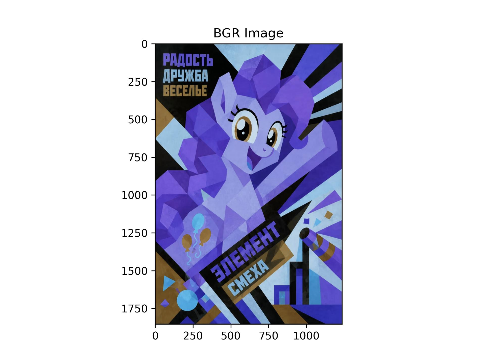
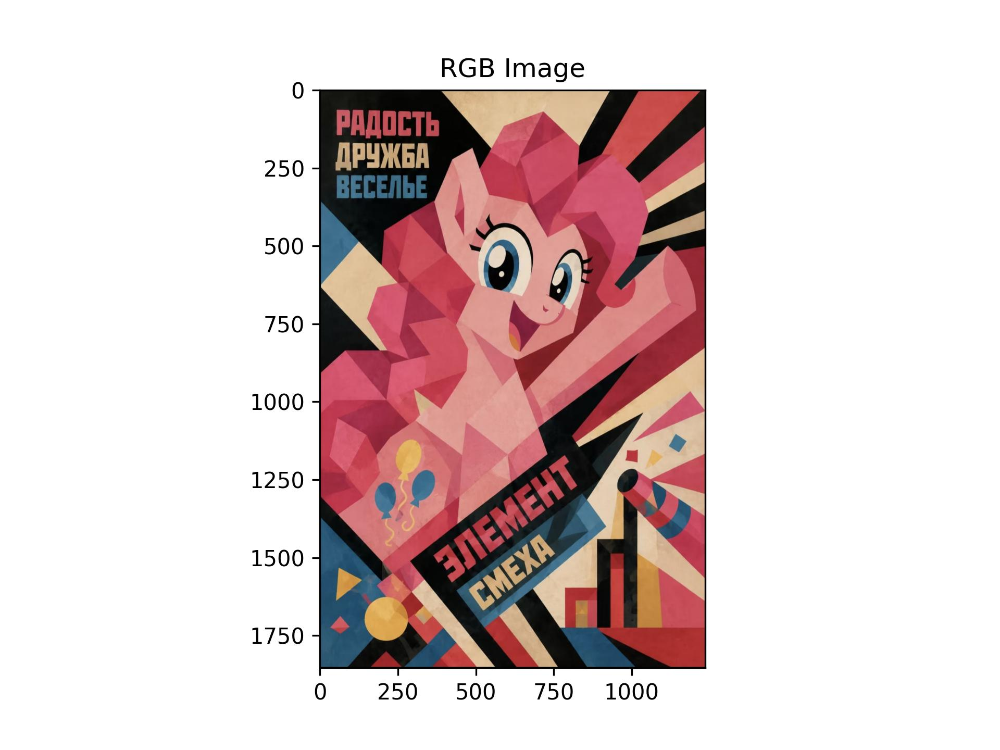
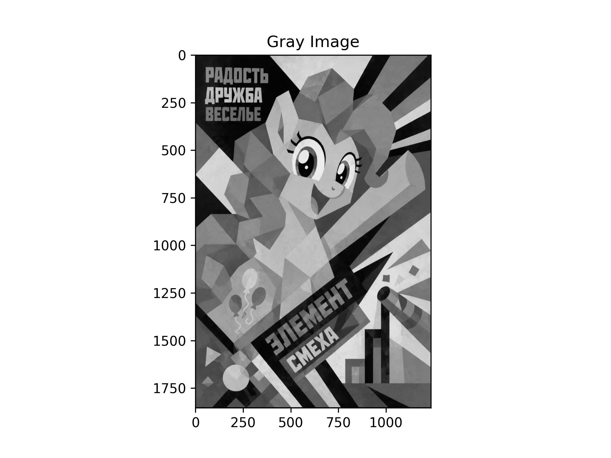
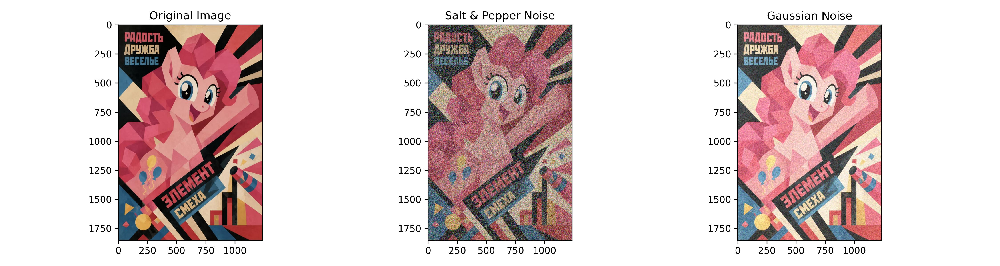
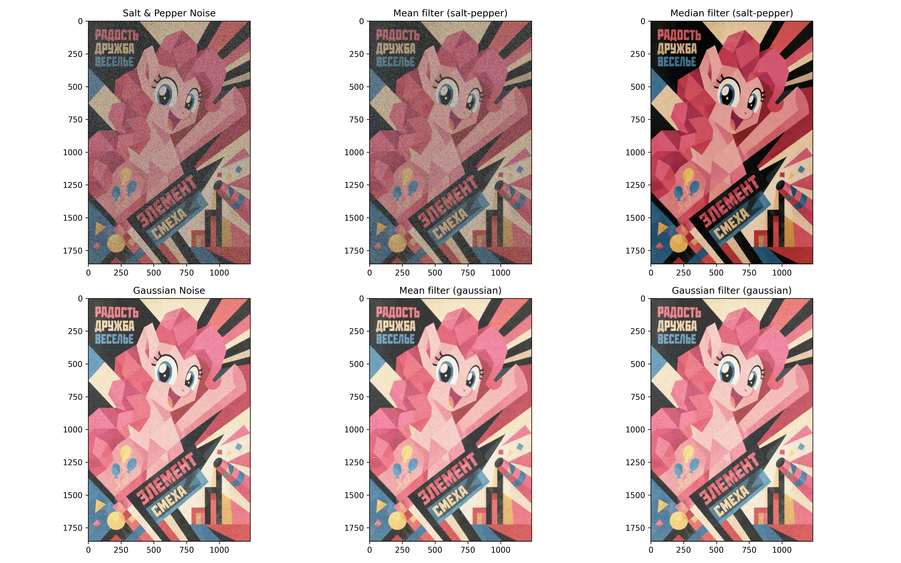
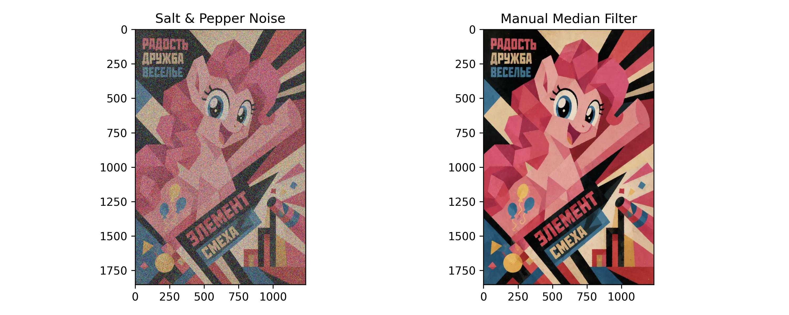

# 实验二：图像增强
人工智能241 邓青阳 202410315030

## 一、实验目的
学会OpenCV的基本使用方法，利用OpenCV等计算机库对图像进行平滑、滤波等操作，实现图像增强，理解BGR/RGB色彩空间差异、噪声类型特点以及不同滤波算法的原理与适用场景。

## 二、实验内容
完整可运行代码见本目录：[Untitled (1).ipynb](./Untitled%20(1).ipynb)

### 2.1 导入依赖包
```python
import cv2
from skimage.util import random_noise
import numpy as np
from matplotlib import pyplot as plt
```
这里导入本次实验要用到的工具包，cv2 用来读取和处理图片，random_noise 用来给图片加噪声，numpy 用来做像素数值处理，matplotlib 用来画图展示图像。

# 2.2 读取原始图像并进行色彩空间转换

读取本地存储的图片文件，提取坐标`(100,100)`位置的 BGR 三通道像素值并打印。从运行输出可以看到，该位置像素的 BGR 数值为`[23, 23, 39]`，整体色调偏深，对应这张小马宝莉宣传海报左上角的深色背景区域。

```
# ====================读取原始图像=====================
img = cv2.imread('p1.jpg')
# 获取图像中【100，100】这个像素的bgr三色
(b, g, r) = img[100, 100]
print("b:", b, "g:", g, "r:", r)
plt.imshow(img)
plt.title('BGR Image')
plt.savefig('output_images/bgr_image.jpg', dpi=300)
plt.show()
```

- 输出：b: 23 g: 23 r: 39

原图：


接下来测试 OpenCV 的色彩空间转换功能。`cv2.cvtColor()`是专门用来切换图像色彩编码格式的函数，参数`cv2.COLOR_BGR2RGB`的作用是交换 B、R 两个通道的顺序。因为 OpenCV 默认以 BGR 顺序读取图片，而 Matplotlib 绘图按照 RGB 顺序解析色彩，不做转换直接展示会出现颜色错乱。

```
# 转化成RGB
rgb_img = cv2.cvtColor(img, cv2.COLOR_BGR2RGB)
plt.imshow(rgb_img)
plt.title('RGB Image')
plt.savefig('output_images/rgb_image.jpg', dpi=300)
plt.show()
```

色彩校正后的 RGB 图：

`cv2.COLOR_BGR2GRAY`可以把彩色图转为灰度图像，将原本三通道的彩色信息压缩为单通道，只保留画面的明暗亮度信息，丢弃色彩数据。

```
# 转换成灰度图
gray_img = cv2.cvtColor(img, cv2.COLOR_BGR2GRAY)
plt.imshow(gray_img, cmap='gray')
plt.title('Gray Image')
plt.savefig('output_images/gray_image.jpg', dpi=300)
plt.show()
```

灰度图：

# 2.3 添加噪声

在已经完成通道校正的 RGB 原图上叠加两种典型图像噪声，方便后续对比滤波器效果。两种噪声的特点有明显区别：椒盐噪声是孤立的黑白噪点，在彩色图上会呈现零散的异色斑点；高斯噪声是叠加在所有像素上、服从正态分布的连续随机偏移，整体画面呈现均匀颗粒感。

```
# ==========================添加噪声=========================
# mode='s&p'代表椒盐噪声，s代表白色噪点，p代表黑色噪点；amount=0.4代表整张图里40%像素会被噪声污染，彩色图上表现为杂乱的彩色斑点
sp_noise_img = random_noise(rgb_img, mode='s&p', amount=0.4)
# mode='gaussian'代表高斯噪声，给每个像素叠加正态分布随机量；本次调整均值、方差参数，放大噪声效果便于观察
gus_noise_img = random_noise(rgb_img, mode='gaussian', mean=0.2, var=0.03)
# 限制像素值范围在【0，1】之间，防止数值溢出
sp_noise_img = np.clip(sp_noise_img,0,1)
gus_noise_img = np.clip(gus_noise_img,0,1)

plt.figure(figsize=(15,4))
plt.subplot(1, 3, 1)
plt.imshow(rgb_img)
plt.title('Original Image')

# 添加椒盐噪声
plt.subplot(1, 3, 2)
plt.imshow(sp_noise_img)
plt.title('Salt & Pepper Noise')

# 田间高斯噪声
plt.subplot(1, 3, 3)
plt.imshow(gus_noise_img)
plt.title('Gaussian Noise')

plt.tight_layout()
plt.savefig('output_images/noise_comparison.jpg', dpi=300)
plt.show()
```

噪声对比图：

# 2.4 图像滤波

对上面生成的两种带噪图像，分别使用均值滤波、中值滤波、高斯滤波这三种空域滤波器处理，横向对比不同滤波器对不同噪声的适配能力。OpenCV 内置滤波函数要求输入图像为`uint8`类型，因此先把 0~1 区间的浮点图像映射回 0~255 并完成类型转换。

```
# =========================图像滤波=============================
# 所有cv滤波都用uint8，避免float运算溢出
sp_noise_uint8 = np.clip(sp_noise_img*255,0,255).astype(np.uint8)
gus_noise_uint8 = np.clip(gus_noise_img*255,0,255).astype(np.uint8)

# 均值滤波
mean_sp = cv2.blur(sp_noise_uint8, (5,5))
mean_gus = cv2.blur(gus_noise_uint8, (5,5))
# 中值滤波
median_sp = cv2.medianBlur(sp_noise_uint8, 5)
median_gus = cv2.medianBlur(gus_noise_uint8, 5)
# 高斯滤波
gauss_sp = cv2.GaussianBlur(sp_noise_uint8, (5,5), 0)
gauss_gus = cv2.GaussianBlur(gus_noise_uint8, (5,5), 0)

plt.figure(figsize=(16,10))
# 第一行图片：椒盐噪声经过三种滤波
plt.subplot(2,3,1)
plt.imshow(sp_noise_uint8)
plt.title('Salt & Pepper Noise')

plt.subplot(2,3,2)
plt.imshow(mean_sp)
plt.title('Mean filter (salt‑pepper)')

plt.subplot(2,3,3)
plt.imshow(median_sp)
plt.title('Median filter (salt‑pepper)')

# 第二行图片：高斯噪声经过三种滤波
plt.subplot(2,3,4)
plt.imshow(gus_noise_uint8)
plt.title('Gaussian Noise')

plt.subplot(2,3,5)
plt.imshow(mean_gus)
plt.title('Mean filter (gaussian)')

plt.subplot(2,3,6)
plt.imshow(gauss_gus)
plt.title('Gaussian filter (gaussian)')

plt.tight_layout()
plt.savefig('result/filter_result.jpg', dpi=300)
plt.show()
```

图像滤波对比图：

# 2.5 手动实现一个滤波方式（中值滤波）

不调用 OpenCV 现成的中值滤波接口，自己编写代码复现中值滤波算法逻辑。依次遍历图像每个像素，对 R、G、B 三个通道分开滑动 5×5 窗口，取窗口内像素的中位数作为输出像素值。最后将手写算法的结果和原始椒盐噪声图并排对照。

```
# ===========================手动实现中值滤波============================
def my_median_filter(image, kernel_size=5):
    h, w, c = image.shape
    pad = kernel_size // 2
    pad_img = np.pad(image, ((pad,pad),(pad,pad),(0,0)), mode='edge')
    out = np.zeros_like(image)
    
    for i in range(h):
        for j in range(w):
            for ch in range(c):
                window = pad_img[i:i+kernel_size, j:j+kernel_size, ch]
                out[i,j,ch] = np.median(window)
    return out

my_median_out = my_median_filter(sp_noise_uint8, kernel_size=5)

plt.figure(figsize=(10,4))
plt.subplot(1,2,1)
plt.imshow(sp_noise_uint8)
plt.title('Salt & Pepper Noise')

plt.subplot(1,2,2)
plt.imshow(my_median_out)
plt.title('Manual Median Filter')

plt.tight_layout()
plt.savefig('result/manual_median.jpg', dpi=300)
plt.show()
```

手动构建中值滤波效果图：

## 四、实验小结

本实验在 Jupyter Notebook 中完成图像读取、BGR-RGB 色彩转换、添加椒盐与高斯噪声，使用多种滤波器完成图像去噪，同时手动实现彩色图像中值滤波。通过实验直观观察不同噪声的特点以及各类滤波器的适用场景，加深了对图像平滑滤波算法原理的理解，掌握 OpenCV 基础图像读写与变换操作。

## 相关文档跳转

- 完整实验代码：[Untitled (1).ipynb](./Untitled%20(1).ipynb)
- 色彩转换、噪声效果图详情：[output_image.md](./output_image.md)
- 滤波去噪结果详情：[result.md](./result.md)
