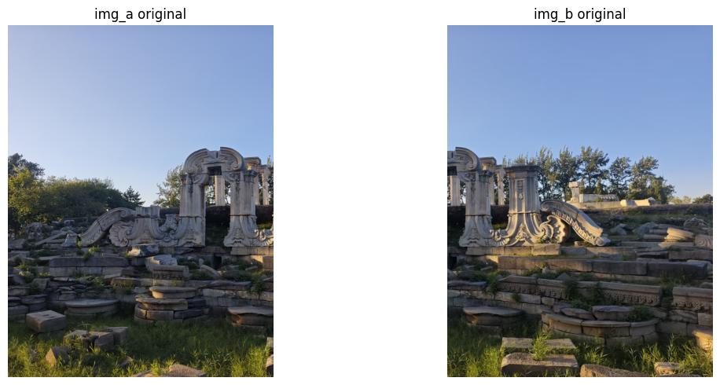
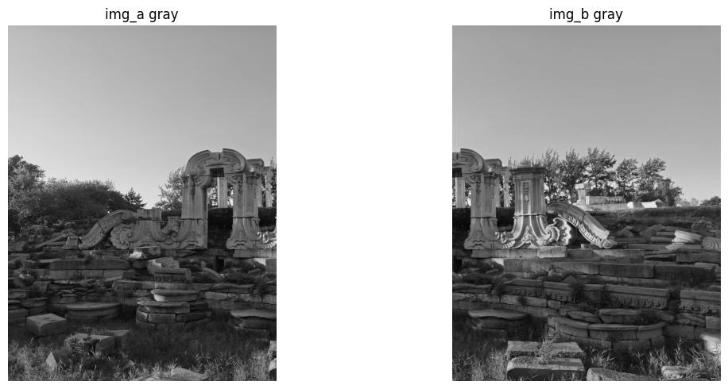
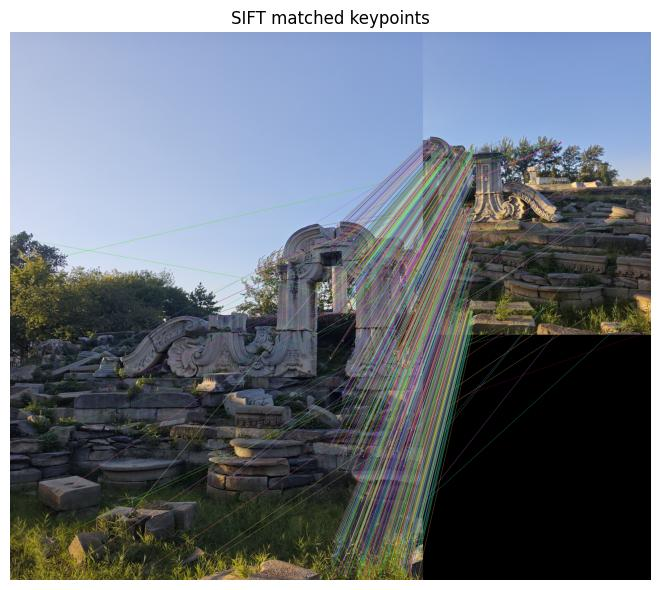
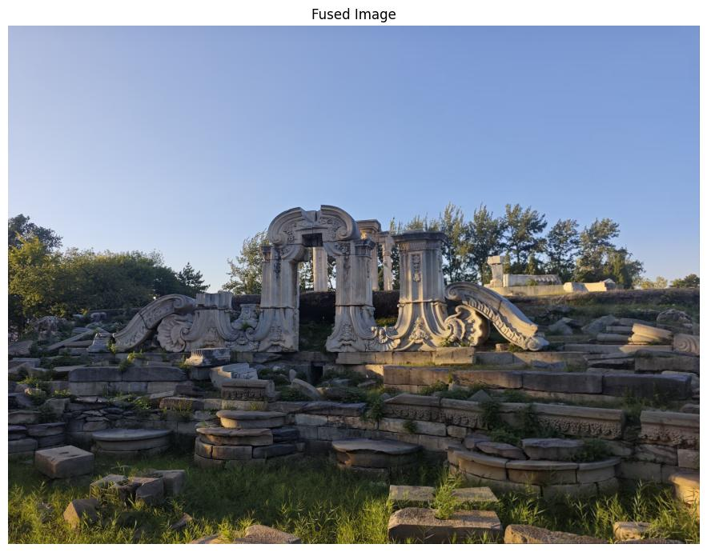
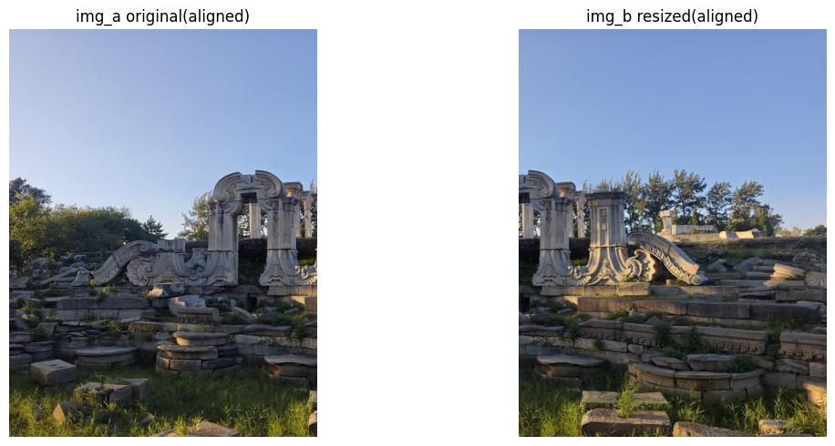
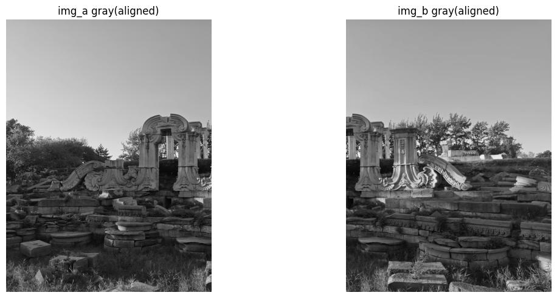
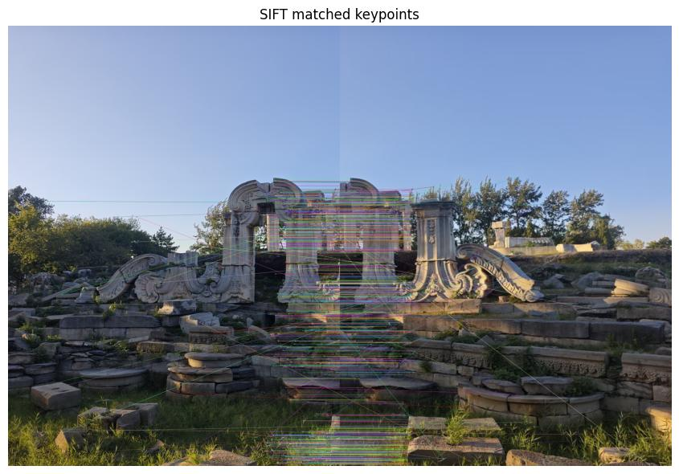
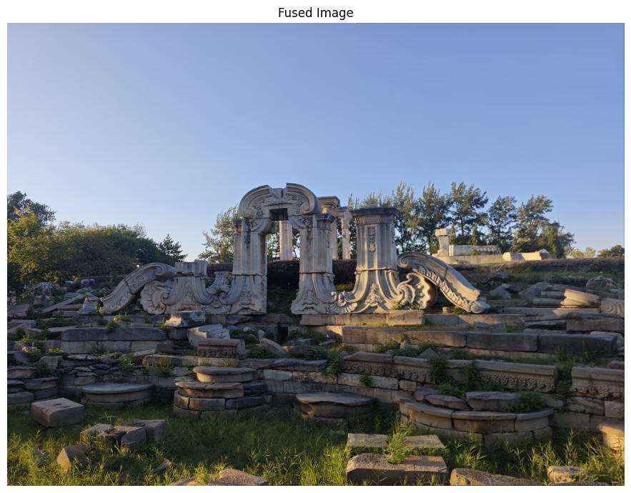

# 基于SIFT特征的图像拼接实验报告
## 一、实验简介
本实验基于SIFT尺度不变特征变换算法，完成两张存在重叠区域图像的特征提取、特征匹配、单应矩阵求解、透视变换与图像融合拼接。

## 二、实验内容（完整可运行代码见本目录：[Untitled1.ipynb](./Untitled1.ipynb) 报告展示图片统一存放于项目根目录 `assets/`）
本次实验步骤包括：
1. 读取两张原图，并转为灰度图；
2. SIFT检测关键点，并使用KNN匹配和Lowe阈值筛选优质匹配点；
3. 图像拼接
具体实验步骤如下：

### 1 未对齐图片尺寸进行试验
#### 1.1 导入依赖包
```python
import cv2
from skimage.util import random_noise
import numpy as np
from matplotlib import pyplot as plt
```
这里导入本次实验要用到的工具包，cv2 用来读取和处理图片，random_noise 用来给图片加噪声，numpy 用来做像素数值处理，matplotlib 用来画图展示图像。

#### 1.2 读取图片并转为灰度图
```python
# 读取两张原图，不做尺寸对齐，转为灰度图
img1 = cv2.imread("p1.jpg")
img2 = cv2.imread("p2.jpg")
gray1 = cv2.cvtColor(img1, cv2.COLOR_BGR2GRAY)
gray2 = cv2.cvtColor(img2, cv2.COLOR_BGR2GRAY)
```

读取两张待拼接实景图像，保留两张图片原始分辨率，不进行 resize 操作，再转换为灰度图用于后续 SIFT 特征提取。

> 
> 
> 图 1：原始彩色输入图，两张图像像素尺寸不一致

> 
> 
> 图 2：原始灰度图，直接使用原图尺寸，未做 resize 对齐

#### 1.3  SIFT检测关键点，并使用KNN匹配和Lowe阈值筛选优质匹配点
```
# SIFT特征提取 + KNN匹配 + Lowe比率筛选
sift = cv2.SIFT_create()
kp1, des1 = sift.detectAndCompute(gray1, None)
kp2, des2 = sift.detectAndCompute(gray2, None)
bf = cv2.BFMatcher()
matches = bf.knnMatch(des1, des2, k=2)
good = []
for m,n in matches:
    if m.distance < 0.7 * n.distance:
        good.append(m)
match_img = cv2.drawMatches(img1, kp1, img2, kp2, good, None)
```

使用 SIFT 算子检测关键点、计算 128 维描述子；采用 KNN 匹配（k=2），通过 Lowe 比率阈值 0.7 过滤错误匹配，绘制匹配连线。因为两张图尺寸不同，绘图函数会自动填充黑色背景补齐画布。

> 
> 
> 图 5：SIFT 关键点匹配可视化，连线为经过 Lowe 筛选后的优质匹配对

#### 1.4 图像拼接结果
```
# RANSAC求解单应矩阵 + 透视变换 + 图像融合
src_pts = np.float32([kp2[m.trainIdx].pt for m in good]).reshape(-1,1,2)
dst_pts = np.float32([kp1[m.queryIdx].pt for m in good]).reshape(-1,1,2)
H, mask = cv2.findHomography(src_pts, dst_pts, cv2.RANSAC, 5.0)
# 透视变换画布计算、平移、叠加融合
```

利用匹配点对，通过 RANSAC 鲁棒求解单应矩阵 H，剔除误匹配外点；对待拼接图像做透视变换，计算全景画布边界，平移坐标消除负边界，最后叠加两张图像完成拼接。

> 
> 
> 图 6：标准图像全景拼接融合结果

### 2 将图片尺寸对齐以后再进行实验

#### 2.1 导入依赖包
```python
import cv2
from skimage.util import random_noise
import numpy as np
from matplotlib import pyplot as plt
```
这里导入本次实验要用到的工具包，cv2 用来读取和处理图片，random_noise 用来给图片加噪声，numpy 用来做像素数值处理，matplotlib 用来画图展示图像。

#### 2.2 读取图片并转为灰度图
```
# 读取原图，将两张图resize到相同分辨率
img1 = cv2.imread("p1.jpg")
img2 = cv2.imread("p2.jpg")
h,w = img1.shape[:2]
img2_resize = cv2.resize(img2, (w,h))
gray1 = cv2.cvtColor(img1, cv2.COLOR_BGR2GRAY)
gray2 = cv2.cvtColor(img2_resize, cv2.COLOR_BGR2GRAY)
```
读取图像后，将第二张图像缩放至和第一张图像相同的宽高，统一分辨率之后再转为灰度图，消除两张图尺寸差异带来的画布黑边。

> 
> 
> 图 3：resize 对齐分辨率后的彩色图

> 
> 
> 图 4：resize 对齐后的灰度图

#### 2.3  SIFT检测关键点，并使用KNN匹配和Lowe阈值筛选优质匹配点
```
# 同样的SIFT、KNN、Lowe筛选流程
sift = cv2.SIFT_create()
kp1, des1 = sift.detectAndCompute(gray1, None)
kp2, des2 = sift.detectAndCompute(gray2, None)
bf = cv2.BFMatcher()
matches = bf.knnMatch(des1, des2, k=2)
good = []
for m,n in matches:
    if m.distance < 0.7 * n.distance:
        good.append(m)
match_img = cv2.drawMatches(img1, kp1, img2_resize, kp2, good, None)
```

使用和上一组完全一致的 SIFT 匹配参数，仅前置增加 resize 对齐步骤。图像分辨率一致后，匹配可视化画布不会出现大块黑色填充区域，画面更加整洁。

> 
> 
> 图 5：SIFT 关键点匹配可视化，连线为经过 Lowe 筛选后的优质匹配对

#### 2.4 图像拼接结果
```
# 单应矩阵求解、透视变换、图像融合流程不变
src_pts = np.float32([kp2[m.trainIdx].pt for m in good]).reshape(-1,1,2)
dst_pts = np.float32([kp1[m.queryIdx].pt for m in good]).reshape(-1,1,2)
H, mask = cv2.findHomography(src_pts, dst_pts, cv2.RANSAC, 5.0)
```

算法逻辑和未对齐组保持完全相同，用来对比图片尺寸变化对拼接效果、匹配可视化的影响。

> 
> 
> 图 6：标准图像全景拼接融合结果

## 三、实验结果与分析
### 1. 特征检测与匹配效果分析
本次实验用到的两张图片，是我从同一张原图里裁切出来的两个局部。一开始裁切的时候没有留意，做完第一组实验才发现两张裁切后的图片尺寸不一样：p1尺寸为3072×2316，p2尺寸为1697×1279。为了看看尺寸不一样会不会影响匹配和拼接效果，我进行了两组实验：
- 实验组1：直接使用裁切出来的原图，保留两张图片原本的尺寸差异；
- 实验组2：把尺寸更小的p2放大，和p1分辨率对齐，统一为3072×2316，其他所有参数保持不变。

两组都使用SIFT提取特征，BFMatcher结合KNN做匹配，Lowe比率阈值设置为0.7来筛选稳定的优质匹配。

**原始尺寸组统计：**
> === 特征匹配统计 ===
> 初始匹配点对数: 49470
> 筛选后优质匹配点对数: 1106
> 优质匹配占比: 2.24%

**尺寸对齐组统计：**
> === 特征匹配统计 ===
> 初始匹配点对数: 49470
> 筛选后优质匹配点对数: 1037
> 优质匹配占比: 2.10%

从数据不难看出拼接照片的优质匹配占比很低，只有2%左右，可能是因为虽然两张图来自同一张原图，但它们只有少部分画面是重叠的，导致优质匹配的占比下降，其别后的原因也可以解释为：代码里`bf.knnMatch(des_a, des_b, k=2)`会把图A提取出来的所有特征，全部拿去和图B的所有特征做检索。那些属于A独有的特征在B中没有真正对应的匹配点，但是算法依然会找到一个相对最像的特征，算作一条初始匹配，全部计入总数。这些无效的候选匹配把分母撑得很大，经过Lowe比率筛选之后，几乎都会被过滤掉，最后占比就很低。但拼接的图片最后看上去效果并不差，这并不是SIFT或者代码出了问题，而是筛选出来的一千多个优质匹配点都集中在重叠区域，数量已经足够用来求解单应矩阵、完成拼接。

对比两组数据可以发现，把小图放大对齐分辨率之后，优质匹配的数量和占比还稍微下降了一点。这是因为放大图片依靠插值生成新像素，画面会变模糊一点，特征描述子稳定性变差，所以稳定匹配点变少。这也说明，单纯把小图强行放大，并不会提升匹配效果，反而会带来负面影响。

0.7是比较常用的经验阈值，用来平衡匹配数量和匹配精度。如果调低阈值，筛选会更严格，匹配数量变少，但匹配会更可靠；调高阈值能留下更多匹配对，但是误匹配也会变多，容易干扰后面单应矩阵的求解。

### 2. 图像拼接质量评估
#### 成功方面
- **配准效果较好**：两组实验都成功算出了单应矩阵H，重叠区域里景物的轮廓能够对齐，说明RANSAC算法可以从这些优质匹配点里，排除掉误匹配点，稳定估计透视变换。就算两张图片尺寸不一样，只要有足够多稳定的匹配点，就可以完成拼接。
- **对照实验的效果明显**：最开始我直接用裁切得到的两张尺寸不同的图片做实验，画匹配图的时候发现旁边出现一大片黑色背景。为了搞清楚这个现象，我才补充了resize对齐分辨率这一组对照实验。对齐之后，匹配图不再出现黑边，画面看着更整洁，方便对比观察。
- **图像没有明显畸变**：透视变换之后，图片主体没有出现撕裂、严重扭曲的情况，几何结构保持连续。

#### 存在问题
- **拼接接缝比较明显**：虽然两张图取自同一张原图，但放大插值之后局部灰度有变化，重叠区域的接缝痕迹比较清楚。
- **黑边问题**：没有对齐尺寸的那一组，拼接结果四周会出现黑色空白区域。这是两张图分辨率不一样导致画布向外扩展产生的无效区域，也是我最开始发现尺寸不一样、想要做对照实验的原因。
- **细节上有微小偏差**：整体对齐看着还行，放大重叠区域细看，部分细节还是存在一点点配准误差，这是特征点定位精度有限，还有单应矩阵假设场景是平面带来的局限。
- **匹配计算效率不高**：初始候选匹配有接近五万对，最后能用的只有一千出头，大部分计算都消耗在那些本来就匹配不上的特征上，浪费了不少算力。

### 3. 影响因素分析
#### 图像质量因素
- 裁切带来的尺寸差异：两张子图是裁切得到的，裁切范围不一样，宽高自然不一样。尺寸不一致本身不会让拼接失败，但会让匹配可视化图出现黑边，透视变换后更容易产生空白区域。
- 图片尺寸缩放：低分辨率图片放大之后，细节被插值抹平，特征稳定性下降，优质匹配数量变少。
- 画面纹理：纹理丰富的地方，能检测出更多SIFT特征；画面平滑、纹理少的区域，很容易产生很多不可靠的相似特征，带来大量误匹配。

#### 算法参数影响
- SIFT自带尺度、旋转不变性，适合本次图像拼接；
- Lowe比率阈值控制筛选的严格程度，直接决定送入RANSAC的匹配点集合；
- RANSAC重投影误差阈值本次设置为5.0，用来判断哪些点是外点；阈值太大容易保留错误匹配，太小又会丢掉有用的内点；
- resize预处理会改变原图像素信息，间接影响特征描述子，改变匹配结果。

## 四、实验总结与心得
### 1. 技术收获
**特征检测方面**
在这次图像拼接实验里，我实操了 SIFT 特征检测，对它的原理有了更直观的认识。SIFT 会先搭建高斯金字塔、DoG 差分高斯空间，以此提取不受尺度变化影响的关键点，再根据关键点周围图像的梯度信息生成描述子，保证特征具备旋转不变性。实验过程里能明显感受到，SIFT 对图片缩放、旋转、光照变化都比较稳定，很适合用来做图像匹配和全景拼接。

**特征匹配方面**
本次实验我使用 FLANN 匹配器完成特征匹配，学会了它的基本用法和简单参数调整。FLANN 依靠 KD 树索引做近似最近邻查找，相比暴力匹配，在特征点数量多的时候速度快很多。另外我用到了 Lowe 比率筛选，也体会到它的作用：原始匹配结果里会混杂不少错误匹配对，用距离比值过滤之后，留下来的优质匹配会更可靠。

**图像配准与拼接方面**
单应性矩阵是图像拼接的关键。我借助 RANSAC 算法，从带误匹配的特征点中估算透视变换矩阵。RANSAC 可以剔除匹配里的外点，就算匹配结果有噪声，也能算出稳定的变换矩阵。这部分内容把课上学的投影几何、矩阵运算和代码结合起来，让我弄懂了怎么把一张图变换对齐到另一张图的坐标系上。

### 2. 实践体会
**学会从实验现象出发，补充对照实验**
一开始裁切图片的时候没有控制分辨率，做完第一组看到匹配图出现大片黑边，我才意识到是两张图片尺寸不一样造成的。于是我新增一组对齐了图片分辨率的实验，保持其他条件不变，只改变图片大小，观察变化。这个过程让我体会到，做实验不一定一开始就要把所有条件想好，可以先做、观察现象，再提出新的想法、补充实验，这是很实用的实验思路。

**参数取舍没有标准答案**
Lowe比率、RANSAC误差阈值这些参数，都需要在匹配数量和匹配精度之间做权衡，不存在一个万能参数，要根据图片纹理、画面重叠情况去调整。

**学会看懂数据、排查问题**
通过观察匹配统计数据、匹配图和最终拼接结果，总结出一些小tips：
优质匹配占比很低，并不是代码写错了，是因为两张图重叠区域很小；拼接错位，大概率是有效内点太少或者RANSAC阈值不合适；接缝明显，融合的效果比较粗糙，可能是融合方式选择不对。
