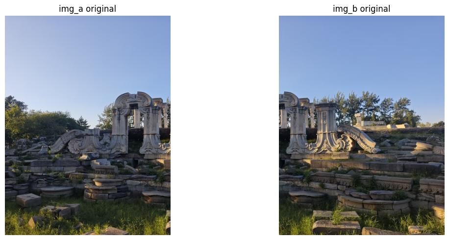
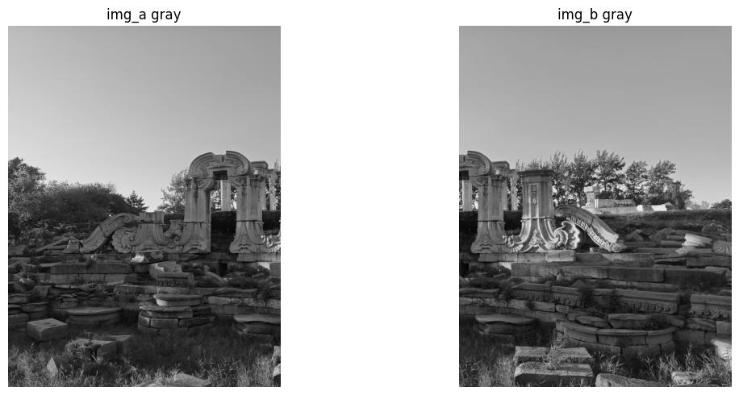
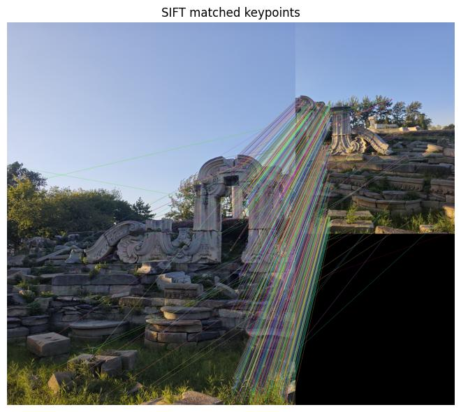
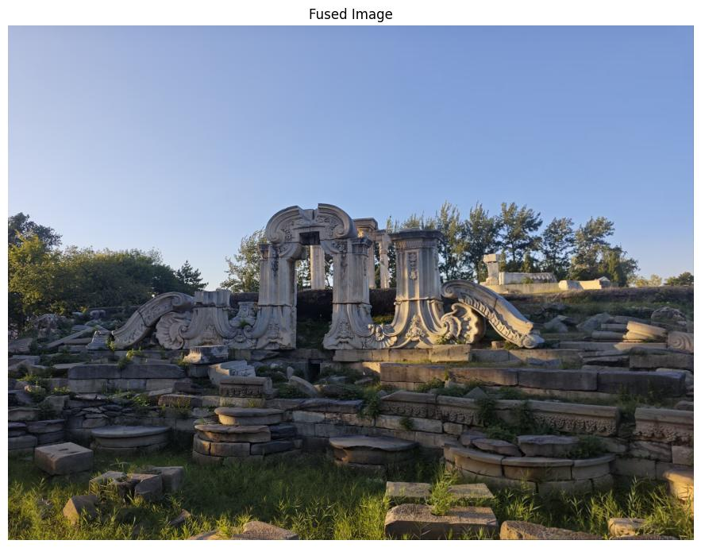
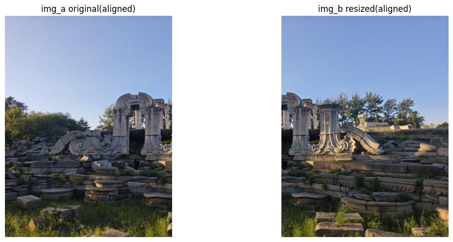
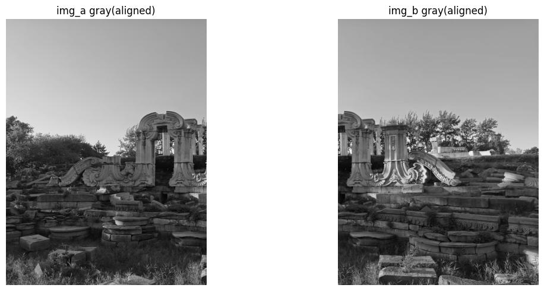
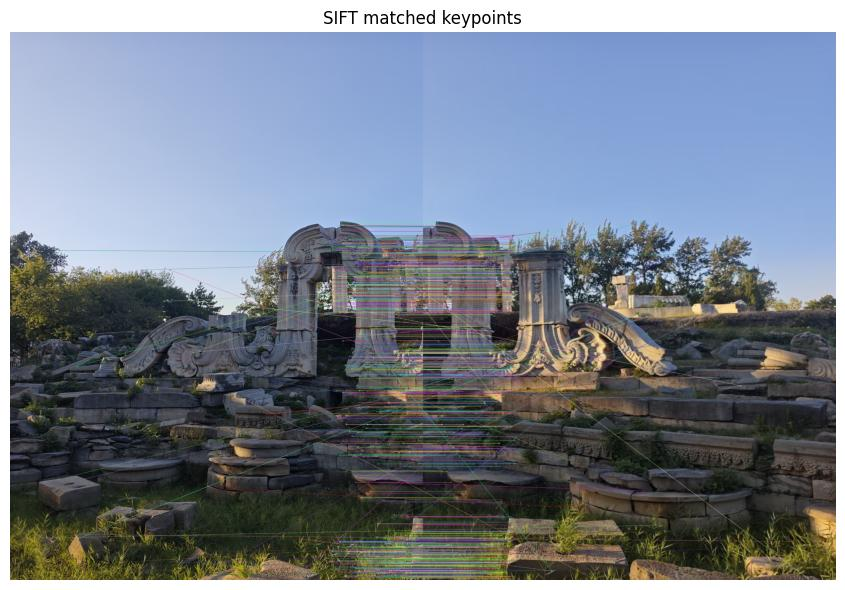
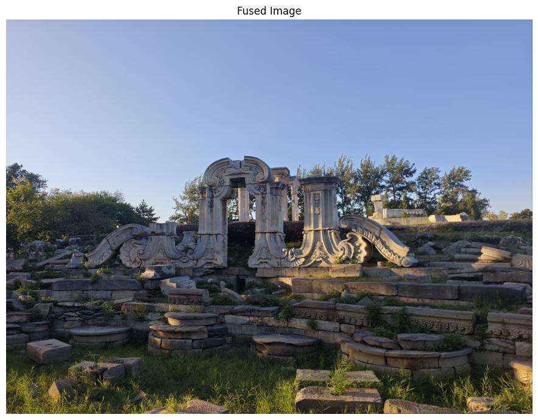

# result/README.md
> 所有结果图片统一存放于项目根目录 `assets/`

## 第一组：未对齐图片尺寸（原始原图）

> 图：input_rgb_raw.jpg，本组原始彩色输入图，两张图像取自同一张大图截取，但像素尺寸不一致，没有做resize对齐。

> 图：input_gray_raw.jpg，本组对应的灰度输入图，直接沿用原始尺寸。

> 图：matched_keypoints_1.jpg，本组SIFT特征匹配可视化结果，展示经过Lowe比率筛选后的优质匹配点连线。

> 图：stitched_result_1.jpg，本组图像拼接输出结果，因为输入尺寸不一致，拼接后会产生较多多余黑边。

## 第二组：对齐图片尺寸（resize统一尺寸）

> 图：input_rgb_aligned.jpg，本组彩色输入图，对两张图像预先resize，统一像素尺寸。

> 图：input_gray_aligned.jpg，本组对应的灰度输入图，和对齐后的彩色图配套。

> 图：matched_keypoints_2.jpg，本组SIFT特征匹配可视化结果，同样使用Lowe比率筛选优质匹配对。

> 图：stitched_result_2.jpg，本组图像拼接输出结果，统一尺寸后拼接黑边更少，画面更加规整。

## 对照说明
两组实验采用一模一样的代码流程：SIFT特征提取、BFMatcher的KNN匹配、Lowe比率筛选、RANSAC求解单应矩阵、透视变换叠加融合。
通过控制“图像是否对齐尺寸”这一个变量，对比观察输入图像尺寸差异对特征匹配效果、全景拼接结果带来的影响。
